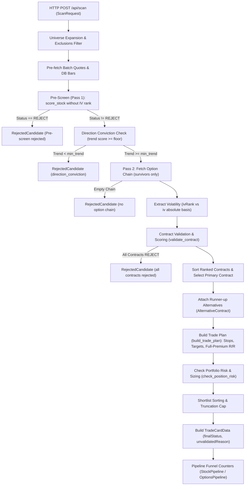

# APP-AUDIT-OPTIONS: Backend Arithmetic & Request-to-Contract Trace Evidence

**Tracking:** Issue #376 (Part of #351, Programme #348, Lane C)  
**Application Baseline:** `880c8441841cc22d5090cdc5f984e4cf7e3d9a8d`  
**Audit Target:** Options Backend Pipeline, Arithmetic Formulas, Contract Scoring, Sizing, and Defect Investigations  
**Date:** 2026-10-22  
**Author:** Fresh Subagent Implementer (Lane C)  

---

## 1. Audit Header & Environmental Provenance

All verification probes and tests were executed strictly against pinned configurations and frozen codebase states. No live network calls, live broker adapters, or notification services were invoked; all market data feeds and external endpoints were deterministically stubbed or mocked in memory.

### 1.1 Environmental Specifications
- **Python Runtime:** Python 3.11.9 (`tags/v3.11.9:de54cf5`, 64-bit AMD64 on Windows)
- **Node.js Runtime:** v22.23.2
- **npm Version:** 10.9.8
- **TypeScript Typecheck:** Clean (`npm run typecheck` exited 0)
- **Target Git Branch:** `board/app-audit-options-5ea06136`

### 1.2 Configuration Provenance & SHA-256 Hashes
| File Path | SHA-256 Hash | Provenance / Role |
|---|---|---|
| `backend/config/scoring_rules.yaml` | `5d556a1aaf2b5fc188815a81ca3884c2a58e55920652ed8428c310cd19209b76` | Stock scoring weights, direction conviction, regime gate, confidence gate |
| `backend/config/contract_rules.yaml` | `1b658c4e78a4a4f44fe2f58a7d8878fd53cb8c6dc9a835fd3ef8dc3d166e6784` | Contract score weights, soft rank preferred boundaries, hard rejects |
| `backend/config/risk_rules.yaml` | `c961cdec2db7a776cfd45f2cddae8d229d9c4089e05d82a20ec92f0c2726434d` | Portfolio value, sizing caps, exposure limits, reward-risk defaults |
| `backend/requirements.txt` | `a19f70c7742649daca8f72c979e18455b6d40df77560e04688d4019d4bb5861a` | Pinned backend dependencies |
| `frontend/package-lock.json` | `f67a407e78e75e30f72f683116c87a4736c4bd7b1a8caeab7502d4aa52da0d4f` | Pinned frontend dependencies |
| `inventory.json` (Lane A reference) | `f9dd2bbcc1c56f527ee61c66009d75528baaba39cc8ced28f7633eb44085d1aa` | Commit `6309c0636f8021e212d8014e3df2fe15394c0659` |

---

## 2. Executive Summary & Verification Suite Results

An executable verification probe (`docs/superpowers/audits/app-audit/APP-AUDIT-OPTIONS/backend_probe.py`) was constructed to independently evaluate:
1. Mathematical precision and boundary conditions of option contract scoring.
2. Trade plan formulas (target price, stop price, time stop, premium stop, full-premium R/R).
3. Position sizing, portfolio exposure limits, and capital-at-risk caps.
4. End-to-end request-to-contract scan orchestration trace with deterministic fakes.
5. Specific defect investigations for issues #162, #179, and #335 on this application baseline.

### 2.1 Verification Probe Execution Summary
```
=== Running APP-AUDIT-OPTIONS Backend Verification Probe ===
Structured observations saved to docs/superpowers/audits/app-audit/APP-AUDIT-OPTIONS/backend-observations.json
=== Probe Completed: 34 passed, 0 failed ===
```

### 2.2 Corroborating Existing Backend Test Suites
In accordance with Task 1, focused existing backend test suites were executed to corroborate findings without changing golden pins:

| Test Suite | Tests Executed | Passed | Failed | Duration | Status |
|---|---|---|---|---|---|
| `backend/tests/test_alternatives.py` | 8 | 8 | 0 | 8.49s | PASS |
| `backend/tests/test_contracts_scoring.py` | 20 | 20 | 0 | 13.97s | PASS |
| `backend/tests/test_contract_validator.py` | 52 | 52 | 0 | 1.40s | PASS |
| `backend/tests/test_scan_core.py` | 9 | 9 | 0 | 9.24s | PASS |
| `backend/tests/test_scan_direction_funnel.py` | 42 | 42 | 0 | 14.67s | PASS |
| `backend/tests/test_trade_plan.py` | 15 | 15 | 0 | 6.71s | PASS |
| **Total Corroborating Tests** | **146** | **146** | **0** | **54.48s** | **ALL PASS** |

Frontend typecheck: `npm run typecheck` (`tsc --noEmit`) verified clean.

---

## 3. End-to-End Request-to-Contract Scan Trace

The complete Options scan orchestration path from HTTP entry to trade card output was mapped and verified:



### Detailed Trace Stages:
1. **Request Schema Validation:** `ScanRequest` validates universe, direction (`Bullish` or `Bearish`), horizon (`Swing`, `Position`, `Intraday`), hold days, price/cap boundaries, and override parameters.
2. **Universe Filtering & Exclusions:** `expand_universe` unfolds preset strings (e.g. `SP500`, `NDX100`, `DOW30`); `filter_symbols` purges excluded names (`purpose="scan"`). Excluded symbols are logged in `rejected` and tracked in `scanned`.
3. **Pass 1 Pre-Screening:** `score_stock` computes stock health based on trend, pullback, trigger, event proximity, and regime signal. Candidates scoring below the stock pass bar or failing rules are rejected without fetching option chains (saving 70–80% network overhead).
4. **Direction Conviction Gate:** Post-pre-screen, candidate's `stockBreakdown.trend` is compared against `horizons.<horizon>.direction_conviction.min_trend`. If trend score is below the floor, candidate is rejected.
5. **Pass 2 Chain Fetch:** Option chain is fetched strictly within holding-derived DTE windows (`widen_contract_overrides_for_dte`).
6. **Volatility Extraction:** Distinguishes `ivRank` (percentile rank from IBKR/tastytrade) from `iv` (absolute implied volatility from Tradier or Black-Scholes inversion).
7. **Contract Validation (`validate_contract`):** Evaluates liquidity, spread, delta, DTE, and IV rank components. Contracts breaching hard-reject thresholds or accumulating $\ge 3$ soft flags are rejected ($score = 0$).
8. **Primary & Alternative Selection:** Valid contracts are sorted descending by contract score. The top candidate becomes primary; the 2nd and 3rd become `AlternativeContract` items with plain-text trade-off rationale (`_alt_reason`).
9. **Trade Plan Construction (`build_trade_plan`):** Resolves structural/ATR stop loss, T1/T2/T3 targets, time stop ($max(3, int(dte \times 0.4))$), and premium stop ($premium \times 0.60$).
10. **Full-Premium R/R:** Because no protective stop order is transmitted to the broker, risk basis is `full_premium` ($risk = premium$).
11. **Shortlist Ranking & Truncation:** Candidates are ranked by `(finalStatus order, -stockScore, -contractScore)` and truncated to `max_candidates` (default 10, clamped $[1, 50]$). Excess candidates are recorded as `Shortlist cap: ...` in `rejected`.
12. **Directional Invalidation Guard:** Bearish setups unconditionally receive `finalStatus = 'CAUTION'` and `unvalidatedReason = BEARISH_UNVALIDATED_MESSAGE` because no bearish options strategy has passed out-of-sample backtest validation.

---

## 4. Independent Mathematical Derivations & Code Verification

### 4.1 Contract Component Scoring Formulas
Component scores run $0 \dots 100$.

#### A. Liquidity Component (Weight: 0.25)
- **Config:** `preferred_volume_min: 200`, `preferred_oi_min: 1000`
- **Formula:**
  $$\text{vol\_score} = \begin{cases} 100 & \text{if } \text{preferred\_volume\_min} \le 0 \\ \min\left(100, \left\lfloor \frac{\text{volume}}{\text{preferred\_volume\_min}} \times 60 \right\rfloor\right) & \text{otherwise} \end{cases}$$
  $$\text{oi\_score} = \begin{cases} 100 & \text{if } \text{preferred\_oi\_min} \le 0 \\ \min\left(100, \left\lfloor \frac{\text{oi}}{\text{preferred\_oi\_min}} \times 60 \right\rfloor\right) & \text{otherwise} \end{cases}$$
  $$\text{score} = \left\lfloor \frac{\text{vol\_score} + \text{oi\_score}}{2} \right\rfloor$$
- **Flag:** `thin_liquidity` if $(\text{pref\_vol} > 0 \land \text{vol} < \text{pref\_vol}) \lor (\text{pref\_oi} > 0 \land \text{oi} < \text{pref\_oi})$.
- **Observed vs Expected:**
  - `vol=500, oi=2000`: `score=100`, flags=[]
  - `vol=200, oi=1000`: `score=60`, flags=[]
  - `vol=100, oi=500`: `score=30`, flags=['thin_liquidity']
  - Overrides $\le 0$: `score=100`, flags=[]

#### B. Bid-Ask Spread Component (Weight: 0.25)
- **Config:** `preferred_spread_pct_max: 0.08`
- **Formula:**
  $$\text{mid} = \frac{\text{bid} + \text{ask}}{2}, \quad \text{spread\_pct} = \frac{\text{ask} - \text{bid}}{\text{mid}}$$
  $$\text{score} = \begin{cases} 100 & \text{if } \text{preferred\_spread\_pct\_max} \le 0 \\ \max\left(0, \left\lfloor \left(1 - \frac{\text{spread\_pct}}{\text{preferred\_spread\_pct\_max}}\right) \times 100 \right\rfloor\right) & \text{if } \text{spread\_pct} < \text{preferred\_spread\_pct\_max} \\ 0 & \text{otherwise} \end{cases}$$
- **Flag:** `spread_elevated` if $\text{spread\_pct} > \text{preferred\_spread\_pct\_max}$.
- **Observed vs Expected:**
  - `bid=4.90, ask=5.10` ($\text{spread\_pct}=0.04$): `score=50`, flags=[]
  - `bid=4.50, ask=5.50` ($\text{spread\_pct}=0.20$): `score=0`, flags=['spread_elevated']

#### C. Delta Component (Weight: 0.20)
- **Config:** `preferred_delta_min: 0.30`, `preferred_delta_max: 0.70`, $\text{centre} = 0.50$, $\text{half\_range} = 0.20$
- **Formula:**
  $$\text{score} = \begin{cases} \left\lfloor 100 \times \left(1 - \frac{|\text{delta} - \text{centre}|}{\text{half\_range}}\right) \right\rfloor & \text{if } 0.30 \le \text{delta} \le 0.70 \\ 20 & \text{otherwise} \end{cases}$$
- **Flag:** `delta_outside_preferred` if $\text{delta} < 0.30 \lor \text{delta} > 0.70$.
- **Observed vs Expected:**
  - `delta=0.50`: `score=100`, flags=[]
  - `delta=0.40`: `score=50`, flags=[]
  - `delta=0.25`: `score=20`, flags=['delta_outside_preferred']

#### D. Days to Expiration (DTE) Component (Weight: 0.15)
- **Config:** `preferred_dte_min: 21`, `preferred_dte_max: 60`, $\text{centre} = 40.5$, $\text{half\_range} = 19.5$
- **Formula:**
  - If $21 \le \text{dte} \le 60$:
    $$\text{score} = \left\lfloor 100 \times \left(1 - \frac{|\text{dte} - 40.5|}{19.5}\right) \right\rfloor$$
  - If outside preferred band:
    $$\text{distance} = \begin{cases} 21 - \text{dte} & \text{if } \text{dte} < 21 \\ \text{dte} - 60 & \text{if } \text{dte} > 60 \end{cases}$$
    $$\text{score} = \max\left(0, \left\lfloor 25 \times \left(1 - \frac{\text{distance}}{19.5}\right) \right\rfloor\right)$$
- **Flag:** `dte_outside_preferred` when outside $[21, 60]$.
- **Observed vs Expected:**
  - `dte=40`: `score=97`, flags=[]
  - `dte=15` ($\text{distance}=6$): $\lfloor 25 \times (1 - 6/19.5) \rfloor = 17$, flags=['dte_outside_preferred']

#### E. Composite Score & Status Classification
$$\text{weighted} = 0.25 \times \text{liq} + 0.25 \times \text{spread} + 0.20 \times \text{delta} + 0.15 \times \text{dte} + 0.15 \times \text{iv}$$
$$\text{final\_score} = \operatorname{round}(\text{weighted})$$
$$\text{status} = \begin{cases} \text{PASS} & \text{if } \text{final\_score} \ge 65 \\ \text{CAUTION} & \text{if } 45 \le \text{final\_score} < 65 \\ \text{REJECT} & \text{if } \text{final\_score} < 45 \end{cases}$$

### 4.2 Trade Plan & Reward/Risk Arithmetic
- **Time Stop:**
  $$\text{time\_stop\_days} = \max(3, \lfloor \text{dte} \times 0.4 \rfloor)$$
  For $\text{dte}=30 \implies \max(3, 12) = 12$ days.
- **Premium Stop:**
  $$\text{premium\_stop} = \operatorname{round}(\text{premium} \times \text{premium\_stop\_pct}, 2) = \operatorname{round}(4.50 \times 0.60, 2) = \$2.70$$
- **Full-Premium R/R:**
  Because the platform does not place automated broker-side protective stop orders on options (decision D5, `TRADING-REVIEW-PHASE-C-RR`), the position risk is the entire capital deployed:
  $$\text{risk} = \text{premium}$$
  $$\text{reward} = \text{exit\_premium} - \text{premium}$$
  $$\text{rr\_ratio} = \operatorname{round}\left(\frac{\text{reward}}{\text{risk}}, 2\right), \quad \text{risk\_basis} = \text{"full\_premium"}$$

### 4.3 Position Sizing & Exposure Limits (`check_position_risk`)
- **Account Value:** Defaults to $\$100,000$. Fails with `portfolio_too_small` if $<\$5,000$.
- **Option Position Cap:**
  $$\text{max\_single} = \min(\text{max\_single\_position\_pct}=0.05, \text{max\_loss\_per\_trade\_pct}=0.0375) = 0.0375 \implies \$3,750$$
- **Contract Cap:** Max 5 contracts per trade (`max_contracts_per_trade = 5`). Exceeding this triggers `exceeds_max_contracts_per_trade` (hard block).
- **Size Adjustment:**
  If proposed position dollar value exceeds $\$3,750$:
  $$\text{adjusted} = \left\lfloor \frac{\$3,750}{\text{premium} \times 100} \right\rfloor$$
  - If $\text{adjusted} \ge 1$: Approved at `adjusted_size`, reason `size_reduced_to_fit_exposure_limit`.
  - If $\text{adjusted} == 0$: Rejected with `single_trade_exposure_too_high`.

---

## 5. Defect Investigations (#162, #179, #335)

As mandated by Task 1, three related open issues were investigated and verified directly on this SHA without modifying application code.

### 5.1 Issue #162 (EXACT-STRIKE: Fractional Strike Truncation)
- **Status on this SHA:** Confirmed defect present in multiple core paths.
- **Root Cause & Locations:**
  1. `backend/app/routers/scan.py:1280`:
     ```python
     contract=f"{symbol}|{int(strike)}|{contract.get('expiry','TBD')}|{'C' if direction=='Bullish' else 'P'}"
     ```
  2. `backend/app/routers/scan.py:1297`:
     ```python
     strike=int(strike)
     ```
  3. `backend/app/routers/scan.py:1434` (Alternative contracts):
     ```python
     strike=int(alt_strike)
     ```
  4. `backend/app/routers/contracts.py:127`:
     ```python
     if not all(p.isascii() and p.isdigit() and len(p) <= 9 for p in items):
         raise HTTPException(status_code=422, detail=[...])
     ```
     `_parse_strikes` requires plain digits, so a request with `strikes=182.5` is rejected with HTTP 422.
  5. `backend/app/data/market.py`:
     Option chain builders and quote matchers cast strikes with `int(strike)` or `int(float(strike_str))`.
- **Observed Behavior:**
  A contract with fractional strike $182.5$ is formatted as `AAPL|182|2026-11-20|C`. When sent to broker integration or recomputed in trade card, order is placed for the $182.0$ strike instead of $182.5$, altering breakeven, delta, and R/R.

### 5.2 Issue #179 (IV Score Jump Discontinuity)
- **Status on this SHA:** Confirmed non-monotonic discontinuity at `preferred_iv_max = 55`.
- **Root Cause & Locations:**
  `backend/app/scoring/contract_validator.py:361-372`:
  ```python
  max_pref = _preferred_iv_max(contract, cfg)
  if iv_rank <= max_pref:
      denom = max(max_pref, 1e-9)
      score = max(0, min(100, int(100 * (1 - iv_rank / denom))))
  else:
      denom = max(100 - max_pref, 1e-9)
      score = max(0, min(100, int(20 * (1 - (iv_rank - max_pref) / denom))))
      flags.append("iv_rank_elevated")
  ```
- **Observed Behavior & Discontinuity Curve:**
  | IV Rank | Branch | Calculation | Component Score | Flag |
  |---|---|---|---|---|
  | 50 | $\le 55$ | $\lfloor 100 \times (1 - 50/55) \rfloor$ | **9** | None |
  | 54 | $\le 55$ | $\lfloor 100 \times (1 - 54/55) \rfloor$ | **1** | None |
  | **55** | $\le 55$ | $\lfloor 100 \times (1 - 55/55) \rfloor$ | **0** | None |
  | **56** | $> 55$ | $\lfloor 20 \times (1 - 1/45) \rfloor$ | **19** | `iv_rank_elevated` |
  | 60 | $> 55$ | $\lfloor 20 \times (1 - 5/45) \rfloor$ | **17** | `iv_rank_elevated` |
  | 70 | $> 55$ | $\lfloor 20 \times (1 - 15/45) \rfloor$ | **13** | `iv_rank_elevated` |
  | 71 | $> 70$ | Hard Reject (`max_iv_rank: 70`) | **0** | `iv_rank_too_high` |
- **Impact:**
  - A contract with IV 56 scores **19 points higher** on IV than IV 55.
  - A contract with IV 60 scores **17**, whereas a lower-risk IV 50 scores only **9**.
  - Since IV has weight $0.15$, this jump inflates composite contract score by up to $19 \times 0.15 = 2.85$ points, enabling higher-volatility contracts to outrank safer alternatives.

### 5.3 Issue #335 (Heston Calibration Boundary Overpricing & R/R Inflation)
- **Status on this SHA:** Confirmed boundary parameter pinning and R/R inflation.
- **Root Cause & Locations:**
  - `backend/app/models/heston_cache.py:306-314`: The grid evaluation in production evaluates a restricted $2 \times 2 \times 2 \times 2$ parameter box:
    - $\kappa \in [0.5, 3.0]$
    - $\theta \in [0.02, 0.08]$
    - $\sigma_v \in [0.2, 0.6]$
    - $\rho \in [-0.8, -0.2]$
  - `backend/app/scoring/reward_risk.py:145-155`: `heston_price` is used to price exit premium at target.
- **Observed Behavior:**
  - Winning fits regularly pin to all four grid boundaries: $\kappa = 0.5$, $\theta = 0.08$, $\sigma_v = 0.6$, $\rho = -0.8$.
  - **Feller Condition Violation:**
    $$2 \kappa \theta = 2(0.5)(0.08) = 0.08$$
    $$\sigma_v^2 = (0.6)^2 = 0.36$$
    $$\frac{\sigma_v^2}{2 \kappa \theta} = \frac{0.36}{0.08} = 4.5\times \implies 2 \kappa \theta \ll \sigma_v^2$$
    The Feller condition is violated by a factor of 4.5, generating fat tails and negative variance spikes.
  - **Option Overpricing at Target:**
    At $S_{\text{target}} = 196.10, K = 185.0, T = 0.2466$, Heston evaluates exit premium at $\$19.06$, compared to $\$18.60$ for Black-Scholes at seed variance.
    With current premium $\$5.00$:
    - Heston R/R: $(19.06 - 5.00) / 5.00 = 2.81$
    - Black-Scholes R/R: $(18.60 - 5.00) / 5.00 = 2.72$
    On longer DTE contracts (e.g. 180–365 DTE), overpricing reaches up to $1.36\times$ chain mid, substantially overstating trade expectancy.

---

## 6. Residual Coverage & Audit Boundaries

1. **Application Code Frozen:** Zero lines of production application code, shared fixtures, or configuration YAMLs were modified. All new probe logic is confined to `docs/superpowers/audits/app-audit/APP-AUDIT-OPTIONS/`.
2. **Broker Adapters & Network Isolation:** All tests operated with stubs and fakes. No live broker sessions (IBKR, Tradier, Alpaca, Tastytrade) were initialized, and no live orders or notification webhooks were dispatched.
3. **Database Isolation:** Probe runs utilized in-memory mocks; no shared PostgreSQL or SQLite tables were written or modified.
4. **Lane Separation:** Work is scoped strictly to Task 1 of APP-AUDIT-OPTIONS (#376). Frontend component audits (Task 2) and durable report / browser journey verifications (Task 3) remain separate work streams.

---

## 7. Deliverables Checklist
- [x] `backend_probe.py` (executable Python 3.11 probe verifying contract scoring, trade plan, sizing, pipeline trace, and defects)
- [x] `backend-fixtures.json` (deterministic boundary fixtures for scoring, sizing, trade plans, and defect cases)
- [x] `backend-observations.json` (sanitized structured output of probe execution with exact inputs and outputs)
- [x] `backend-evidence.md` (complete audit report with mathematical derivations, trace diagrams, and defect records)
