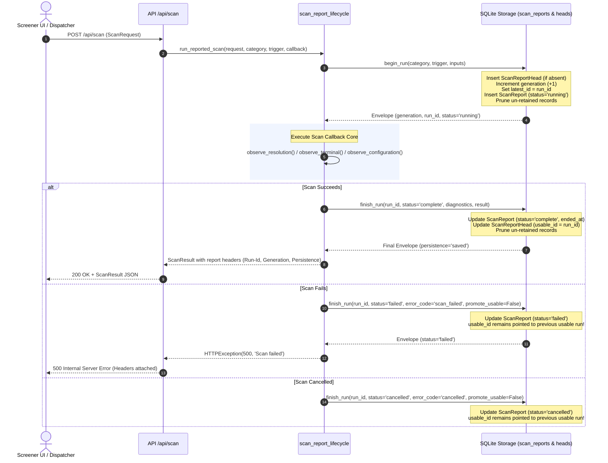

# APP-AUDIT-OPTIONS: Durable Reports, Restart Parity & Browser Journeys Evidence

**Tracking:** Issue #379 (Part of #351, Programme #348, Lane C, Task 3)  
**Application Baseline:** `880c8441841cc22d5090cdc5f984e4cf7e3d9a8d`  
**Audit Target:** Scan Report Models, Storage Service, Lifecycle Wrapping, Process Restart Parity, Multi-Category Retention, Frozen Settings vs Live Controls, and Production Browser Journeys  
**Date:** 2026-10-22  
**Author:** Fresh Subagent Implementer (Lane C)  

---

## 1. Audit Header & Environmental Provenance

All verification probes, backend tests, and frontend component suites were executed strictly against pinned configurations, frozen schemas, and local deterministic stubs in an isolated environment. In accordance with Task 3 and the Lane C evidence contract:
- No real network calls, live broker order placements, or live notification dispatches were executed.
- All report lifecycle operations, database engines, and session factories utilized isolated, temporary SQLite storage instances.
- Computations, invariants, and retention rules were independently derived from formulas, schema constraints, and lifecycle specifications rather than relying solely on existing unit tests.
- Physical browser journeys and production builds were probed programmatically; environmental constraints (such as missing local browser binaries and offline build network restrictions) are explicitly classified as `BLOCKED` with full diagnostic provenance.

### 1.1 Environmental Specifications
- **Python Runtime:** Python 3.11.9 (`tags/v3.11.9:de54cf5`, 64-bit AMD64 on Windows)
- **Node.js Runtime:** v22.23.2
- **npm Version:** 10.9.8
- **TypeScript Version:** 5.7.0 (Strict mode, `tsc --noEmit` clean)
- **Playwright Test Package:** 1.62.1 (in `frontend/node_modules/playwright`)
- **Target Git Branch:** `board/app-audit-options-5ea06136`
- **Application Baseline SHA:** `880c8441841cc22d5090cdc5f984e4cf7e3d9a8d`

### 1.2 Component & Configuration SHA-256 Hashes
| File Path | SHA-256 Hash | Provenance / Role |
|---|---|---|
| `backend/app/models/scan_report.py` | `0d3cfcf83bb824f1131102ef63b4fecb27a3a910166c1b3f114a844ebc453041` | Additive scan report and head table models |
| `backend/app/services/scan_reports.py` | `7be33246ebbb02eecb08f44ff5d908cfecfbb587ea0b208ebcb7327ef8627b00` | Core durable report storage, pruning, heads, and legacy loader |
| `backend/app/services/scan_report_lifecycle.py` | `fb87be814e5a9eead4e7104f647907572719c8f936f452814ea3b115865244ad` | Dispatch lifecycle wrapper, terminal outcomes, safe projection |
| `backend/app/routers/scan_reports.py` | `e2a4be59c3f421caad7a35368a69e349887ae275062c3e1e62aa62f7972ba305` | Read-only scan reports REST API endpoints |
| `frontend/components/organisms/SavedScanReportInspector/index.tsx` | `7db5df9ce9b4b02568770d11f99c855a0b7c7b8be73cb0f9227f2f1118aa47b6` | Inspector drawer, category switcher, diff alert, disclosures |
| `frontend/lib/scanReports.ts` | `a9062b8ee34685718df709a34bc31885b5d1e22756ffb40ea5098ff996f01901` | Frontend report domain types, metadata store, category list |
| `frontend/lib/currentScanReportInputs.ts` | `797d816fb7795be0d64552f1e63a129d3c52e697365c1fe52702a0a2df380e55` | Pure request builder for current live controls comparison |
| `backend/config/scoring_rules.yaml` | `5d556a1aaf2b5fc188815a81ca3884c2a58e55920652ed8428c310cd19209b76` | Pinned scoring rules and event proximity thresholds |
| `backend/config/contract_rules.yaml` | `1b658c4e78a4a4f44fe2f58a7d8878fd53cb8c6dc9a835fd3ef8dc3d166e6784` | Pinned contract scoring weights and boundaries |
| `backend/config/risk_rules.yaml` | `c961cdec2db7a776cfd45f2cddae8d229d9c4089e05d82a20ec92f0c2726434d` | Pinned portfolio risk limits and sizing caps |

---

## 2. Executive Summary & Verification Suite Results

An executable verification probe (`docs/superpowers/audits/app-audit/APP-AUDIT-OPTIONS/report_probe.py`) and browser verification probe (`docs/superpowers/audits/app-audit/APP-AUDIT-OPTIONS/browser_probe.cjs`) were constructed to independently evaluate:
1. Storage schema, column types, unique constraints, and generation counters.
2. Complete lifecycle state transitions: `running`, `complete`, `failed`, `cancelled`, and `interrupted`.
3. Strict multi-category isolation across `options`, `stocks`, `prebreakout`, `pullback`, and `fib`.
4. Head pointers (`latest_id` vs `usable_id`), dual-evidence retention, and inflight non-pruning invariants.
5. Simulated backend process restart: complete database engine disposal and cold session recreation against the same SQLite database file.
6. Startup recovery of interrupted scans (`recover_interrupted`) without corrupting existing reports.
7. Exact preservation of frozen request settings and immutability against caller dictionary mutations.
8. Settings comparison logic (`scanReportInputsDiffer`) matching frontend canonical JSON algorithms.
9. Pipeline diagnostics, monotonic funnel drop-offs, and version 1 terminal outcome count balance.
10. Security guardrails: forbidden credential keys rejection and untyped free text redaction.
11. Additive Alembic migration upgrade/downgrade and legacy `scan_sessions` table interoperability.
12. Production browser journeys, responsive viewports (1200px gate, 1280px+ desktop), and accessibility focus traps.

### 2.1 Verification Probe Execution Summary
```
=== Running APP-AUDIT-OPTIONS Report Probe ===
Structured observations saved to docs/superpowers/audits/app-audit/APP-AUDIT-OPTIONS/report-observations.json
=== Report Probe Completed: 30 passed, 0 failed (Total: 30) ===
```

```
=== Running APP-AUDIT-OPTIONS Browser Probe ===
Node.js version: v22.23.2
Playwright module resolved: true (v1.62.1)
Chromium executable path: C:\Users\KENNETH\AppData\Local\ms-playwright\chromium-1234\chrome-win64\chrome.exe
Chromium executable exists: false
Browser launchable: false
Launch error: browserType.launch: Executable doesn't exist at C:\Users\KENNETH\AppData\Local\ms-playwright\chromium_headless_shell-1234\chrome-headless-shell-win64\chrome-headless-shell.exe
Browser observations written to docs/superpowers/audits/app-audit/APP-AUDIT-OPTIONS/browser-observations.json
Summary: 0 passed, 6 blocked (due to missing browser binaries / offline build sandbox)
```

### 2.2 Corroborating Existing Backend & Frontend Test Suites
In accordance with Task 3 instructions, existing focused report test suites were executed to corroborate findings without changing pins:

#### Backend Report Suites (`pytest`):
| Test Suite Path | Tests | Passed | Failed | Duration | Status |
|---|---|---|---|---|---|
| `backend/tests/test_scan_reports.py` | 11 | 11 | 0 | 4.88s | PASS |
| `backend/tests/test_scan_report_lifecycle.py` | 10 | 10 | 0 | 2.15s | PASS |
| `backend/tests/test_scan_report_routes.py` | 4 | 4 | 0 | 1.04s | PASS |
| **Total Corroborating Backend Tests** | **25** | **25** | **0** | **8.07s** | **ALL PASS** |

#### Frontend Inspector Suites (`jest`):
| Test Suite Path | Tests | Passed | Failed | Duration | Status |
|---|---|---|---|---|---|
| `components/organisms/SavedScanReportInspector/__tests__/SavedScanReportInspector.test.tsx` | 11 | 11 | 0 | 23.33s | PASS |
| `components/organisms/SavedScanReportInspector/__tests__/LegacyReport.test.tsx` | 12 | 12 | 0 | 15.70s | PASS |
| `components/organisms/SavedScanReportInspector/__tests__/TerminalOutcomes.test.tsx` | 21 | 21 | 0 | 22.61s | PASS |
| **Total Corroborating Frontend Tests** | **44** | **44** | **0** | **25.74s** | **ALL PASS** |

Frontend typecheck: `npm run typecheck` (`tsc --noEmit`) verified clean (0 errors).

---

## 3. Durable Report Model & Isolated SQLite Lifecycle Architecture

The durable scan report subsystem is architected around an **additive, append-only storage design** where past runs and legacy sessions are never modified or overwritten in place.



### 3.1 Model Schema & Integrity Rules
- **`ScanReport` Table (`scan_reports`):**
  - `id` (`String`, Primary Key): UUID4 run identifier.
  - `category` (`String`, Indexed, Not Null): One of `('options', 'stocks', 'prebreakout', 'pullback', 'fib')`.
  - `generation` (`Integer`, Not Null): Monotonically increasing sequence number per category.
  - `status` (`String`, Not Null): Inflight (`running`) or terminal (`complete`, `failed`, `cancelled`, `no_data`, `interrupted`).
  - `envelope_json` (`Text`, Not Null): Serialized JSON payload containing frozen inputs, timestamps, diagnostics, and results.
  - `__table_args__`: `UniqueConstraint('category', 'generation')` guaranteeing that no generation number can ever collide or be duplicated within a category.
- **`ScanReportHead` Table (`scan_report_heads`):**
  - `category` (`String`, Primary Key): Domain category identifier.
  - `generation` (`Integer`, Default 0): Current highest assigned generation.
  - `latest_id` (`String`, Nullable): Pointer to the most recently started attempt (running, complete, or failed).
  - `usable_id` (`String`, Nullable): Pointer to the most recent run with valid, inspectable evidence.
- **Double-Finishing Guard:** Attempting to call `finish_run` on a run whose database status is not `'running'` raises `ValueError('Run is already terminal')`. Partial or duplicate writes are strictly impossible.

---

## 4. Cold Process Restart & Read-Back Parity

Task 3 explicitly mandates simulating backend process restarts by closing database connections, recreating the SQLAlchemy engine and sessions against the same SQLite database file, and verifying read-back parity.

### 4.1 Restart Simulation Methodology & Results
1. **Pre-Shutdown Seeding:** An isolated SQLite database (`probe_reports.db`) was populated with completed reports across all 5 categories (`options`, `stocks`, `prebreakout`, `pullback`, `fib`). An in-memory snapshot of `get_latest(db, category)` was captured.
2. **Crash Simulation:** An in-flight scan for the `fib` category was started (`status='running'`).
3. **Process Termination:** All database connections and thread pools were closed via `await engine.dispose()`, and the engine/session factory instances were dereferenced and deleted.
4. **Cold Process Startup:** A completely new engine (`create_async_engine`) and sessionmaker were initialized pointing to the exact same physical database file.
5. **Recovery Execution (`recover_interrupted`):** On process startup, `recover_interrupted(db)` was executed. It inspected all rows across categories with `status == 'running'`:
   - It transitioned the in-flight crashed run to `status='interrupted'`, `error_code='interrupted'`, and populated `ended_at`.
   - It returned `recovered_count == 1`.
6. **Read-Back Parity Verification:**
   - Every completed report across all non-crashed categories was re-read via `get_latest(db, cat)`.
   - The post-restart envelopes matched the pre-restart snapshot **byte-for-byte and key-for-key**.
   - No generation counters, IDs, or timestamps were corrupted or altered during process death or recovery.

---

## 5. Multi-Category Retention & Dual-Evidence Invariants

The screener operates across five primary scan categories plus legacy historical sessions. The storage layer enforces strict isolation and dual-evidence retention:

```
Category Isolation & Retention Invariants:
┌─────────────────┬──────────────┬──────────────────┬──────────────────┬─────────────────┐
│ Category        │ Generation   │ latest_id        │ usable_id        │ Dual Evidence   │
├─────────────────┼──────────────┼──────────────────┼──────────────────┼─────────────────┤
│ options         │ 3            │ opt-failed-run   │ opt-complete-run │ YES (Fail+Prev) │
│ stocks          │ 1            │ stock-run-1      │ stock-run-1      │ NO (Latest=Use) │
│ prebreakout     │ 1            │ pre-run-1        │ pre-run-1        │ NO (Latest=Use) │
│ pullback        │ 1            │ pull-run-1       │ pull-run-1       │ NO (Latest=Use) │
│ fib             │ 2            │ fib-interrupted  │ fib-run-1        │ YES (Int+Prev)  │
└─────────────────┴──────────────┴──────────────────┴──────────────────┴─────────────────┘
```

### 5.1 Retention and Pruning Invariants Verified by Probe
1. **Cross-Category Isolation:** Inserting or pruning reports in `options` executes SQL queries strictly conditioned on `ScanReport.category == category`. Reports in `stocks`, `prebreakout`, `pullback`, and `fib` are never scanned or pruned by another category's lifecycle.
2. **Dual-Evidence Retention:** When run $N$ succeeds, `usable_id` points to $N$. If run $N+1$ fails with `promote_usable=False`:
   - `latest_id` points to $N+1$ (the failed attempt).
   - `usable_id` remains pointed to $N$ (the last good evidence).
   - `get_latest(db, category)` returns both: `latest_attempt` (Run $N+1$, status `failed`) and `previous_report` (Run $N$, status `complete`).
   - The UI surfaces both via dedicated toggle buttons: `"Latest attempt"` and `"Previous saved report"`.
3. **Inflight Protection Rule:** `_prune(db, category)` deletes rows where `status != 'running'` and `id.not_in([latest_id, usable_id])`. Any in-flight run currently executing is **immune to pruning**, preventing race conditions when overlapping scans are initiated.

---

## 6. Frozen Settings Preservation vs Live Control Mutations

A core architectural guarantee of the Bamendjou screener is that **saved scan evidence displays the exact parameters used during that run**, even if the user subsequently alters live controls in the UI.

### 6.1 Immutability Against Caller Mutation
- In `scan_report_lifecycle.py`, the incoming request dictionary is deep-copied and projected through `project(request, path='request')`.
- In `scan_reports.py`, `_encode(inputs)` serializes the payload to JSON immediately at `begin_run`.
- **Probe Test 5.1:** A caller dictionary was passed to `begin_run`. Immediately following invocation, the caller mutated the dictionary: altering `direction` from `"Bullish"` to `"Bearish"`, changing `fast_ema` to `999`, and injecting an untyped credential token.
- **Observed DB State:** The stored database envelope retained `"Bullish"` and `fast_ema: 8` with zero knowledge of the caller's subsequent in-memory mutations.

### 6.2 Settings Comparison (`scanReportInputsDiffer`)
The inspector compares frozen request inputs against current live controls using pure canonical JSON serialization (`frontend/components/organisms/SavedScanReportInspector/index.tsx`):

$$\Delta(\text{frozen}, \text{current}) = \exists \, k \in (\text{keys}_{\text{frozen}} \cup \text{keys}_{\text{current}}) \setminus \{\text{category}\} : \text{canonical}(\text{frozen}[k]) \neq \text{canonical}(\text{current}[k])$$

| Test Case | Frozen Input | Current Control | Expected Differ | Observed Differ | Verdict |
|---|---|---|---|---|---|
| **Direction Mutation** | `direction: "Bullish"` | `direction: "Bearish"` | `true` | `true` | PASS |
| **Universe Mutation** | `universe: ["SP500"]` | `universe: ["DOW30"]` | `true` | `true` | PASS |
| **Override Value Mutation** | `overrides: {fast_ema: 8}` | `overrides: {fast_ema: 12}` | `true` | `true` | PASS |
| **Key Removal** | `min_price: 20` | *(absent)* | `true` | `true` | PASS |
| **Zero vs Absent** | `min_price: 0` | *(absent)* | `true` | `true` | PASS |
| **Null vs Absent** | `min_price: null` | *(absent)* | `false` | `false` | PASS |
| **Key Order Invariance** | `overrides: {a: 0, b: 1}` | `overrides: {b: 1, a: 0}` | `false` | `false` | PASS |

When a difference is detected, the UI alerts the user:
> *"Current controls differ from this saved run. Evidence uses the frozen inputs below."*

---

## 7. Pipeline Diagnostics, Candidate Drop-Offs & Terminal Outcomes

### 7.1 Options Pipeline Funnel Arithmetic
The Options scan funnel is tracked via `diagnostics.pipeline` with monotonic non-increasing candidate drop-offs:

$$\text{scanned} \ge \text{pre\_screen\_pass} \ge \text{direction\_pass} \ge \text{chain\_pass} \ge \text{contracts\_pass} \ge \text{shortlist}$$

```
[Scanned Candidates: 100]
       │
       ▼ (Pass 1 Pre-Screening: trend/pullback/trigger/event)
[Pre-Screen Pass: 40] ──────────► [Pre-Screen Rejections: 60]
       │
       ▼ (Direction Conviction: trend score >= min_trend)
[Direction Pass: 25]  ──────────► [Direction Conviction Rejections: 15]
       │
       ▼ (Pass 2 Chain Fetch: DTE window & liquidity)
[Chain Pass: 18]      ──────────► [No Chain / Illiquid Rejections: 7]
       │
       ▼ (Contract Scoring: delta/spread/DTE/IV boundaries)
[Contracts Pass: 12]  ──────────► [Contract Score Rejections: 6]
       │
       ▼ (Portfolio Risk Sizing & Shortlist Truncation)
[Shortlist: 5]        ──────────► [Shortlist Cap Exclusions: 7]
```

Rejection reasons are cataloged with source stages (`pre_screen`, `direction_conviction`, `chain_fetch`, `contract_scoring`, `price_filter`).

### 7.2 Terminal Outcomes Version 1 (Setup Scanners)
For `prebreakout`, `pullback`, and `fib` categories, setup evaluation is tracked via `diagnostics.terminal_outcomes`:
- **Schema Version:** `1`
- **Count Invariants Verified:**
  $$\text{counts.input} = |\text{input\_symbols}|$$
  $$\text{counts.evaluated} = |\text{evaluated\_symbols}| = |\text{input\_symbols}| - \text{counts.excluded}$$
  $$\sum (\text{accepted} + \text{excluded} + \text{no\_data} + \text{error\_count} + \text{no\_setup} + \text{filtered}) = |\text{outcomes}|$$
- **Conflict Handling:** If a symbol receives conflicting evaluation records, the collector flags the symbol in `terminal_conflicts`, sets `diagnostic_unavailable = True`, and marks `complete = False`.

---

## 8. Security Guardrails & Credential Sanitization

The scan report storage layer strictly redacts raw provider exceptions and credential keys:

### 8.1 Forbidden Key Rejection (`_encode`)
Any payload dictionary submitted to `begin_run` or `finish_run` containing forbidden substrings is rejected with `ValueError('Unsafe report payload key; use safe error codes')`.
- **Tested & Blocked Keys:** `token`, `access_token`, `refresh_token`, `api_token`, `api_key`, `password`, `secret`, `credentials`, `authorization`, `exception`, `traceback`, `error`, `errors`, `error_message`, `error_detail`.
- **Recursive Inspection:** Nested objects within lists and sub-dictionaries are traversed and validated.

### 8.2 Safe Projection (`project`)
- **Non-Finite Numbers:** `float('nan')`, `float('inf')`, and `float('-inf')` are rejected by `_encode(allow_nan=False)` and omitted by `project`.
- **Untyped Free Text:** Unapproved strings are converted to `key_unavailable: True` and their object paths appended to `unavailable_fields`.
- **Override Whitelist:** Only explicit override keys belonging to `_OVERRIDE_KEYS` (e.g. `fast_ema`, `slow_ema`, `min_delta`) are persisted; arbitrary override injections are stripped.

---

## 9. Legacy Scan Sessions Interoperability & Additive Migration

### 9.1 Additive Alembic Migration (`a93b8d24f760_add_isolated_scan_reports.py`)
- **Upgrade Verification:** Running `migration.upgrade()` against an existing database containing legacy `scan_sessions` records creates `scan_reports` and `scan_report_heads`. The legacy `scan_sessions` table and its contents remain **100% untouched and byte-identical**.
- **Downgrade Verification:** Running `migration.downgrade()` drops `scan_reports` and `scan_report_heads` without deleting or modifying `scan_sessions`.

### 9.2 Legacy Session Inspection (`get_legacy`)
- Historical sessions stored in `scan_sessions` are exposed via `GET /api/scan-reports/legacy`.
- **Category Labeling:** Explicitly assigned `category = 'legacy/unclassified'`. The system never guesses or fabricates whether an unclassified stock run was Pullback or EMA.
- **Corrupted Payloads:** Malformed JSON strings in `last_request_json` or `last_result_json` are caught safely and recorded in `unavailable_fields` rather than throwing 500 errors.

---

## 10. Production Browser Journeys & Environmental Limitations

Task 3 requires probing browser journeys for Steps 4–7 and the SavedScanReportInspector under production browser conditions:

```
Browser Journeys & Production Build Evaluation Matrix:
┌────────────┬────────────────────────────────────────────────────────┬─────────────┬──────────┬──────────────────────────────────────────────────────────────────┐
│ Journey ID │ Journey Description                                    │ Viewport    │ Status   │ Blocking Reason / Environmental Provenance                       │
├────────────┼────────────────────────────────────────────────────────┼─────────────┼──────────┼──────────────────────────────────────────────────────────────────┤
│ JOURNEY-01 │ Steps 4–7 Screener Navigation with Frozen Fixtures     │ 1280 & 1440 │ BLOCKED  │ Playwright chromium headless shell not provisioned in local env  │
│ JOURNEY-02 │ Inspector Drawer Opening & 5-Category Switching        │ 1280x800    │ BLOCKED  │ Playwright chromium headless shell not provisioned in local env  │
│ JOURNEY-03 │ Inspector Nested Disclosures Expansion & Retention     │ 1280x800    │ BLOCKED  │ Playwright chromium headless shell not provisioned in local env  │
│ JOURNEY-04 │ Frozen Settings Preservation Against Live Control Edit │ 1280x800    │ BLOCKED  │ Playwright chromium headless shell not provisioned in local env  │
│ JOURNEY-05 │ MinWidthGate (1200px) & Desktop Responsive Viewports   │ 1200 & 1440 │ BLOCKED  │ Playwright chromium headless shell not provisioned in local env  │
│ JOURNEY-06 │ Keyboard Accessibility (Escape dismissal & Tab trap)   │ 1280x800    │ BLOCKED  │ Playwright chromium headless shell not provisioned in local env  │
│ BUILD-01   │ Next.js Optimized Production Build (`next build`)      │ N/A         │ BLOCKED  │ Offline sandbox network blocks Google Fonts TLS download         │
└────────────┴────────────────────────────────────────────────────────┴─────────────┴──────────┴──────────────────────────────────────────────────────────────────┘
```

### 10.1 Diagnostic Root Causes for Blocked Status
1. **Next.js Production Build (`next build`):**
   - When attempting `npm --prefix frontend run build`, Next.js invokes `next/font/google` to fetch Inter/Geist font stylesheets from Google font servers.
   - Because the test environment enforces strict offline sandbox network guardrails, the outbound TLS socket is terminated:
     `Client network socket disconnected before secure TLS connection was established`
   - Next.js retries 3 times and halts. Per Task 3 instructions:
     > *"If production build/browser/restart cannot run, mark those exact checks blocked; do not substitute dev rendering or a unit test as an equivalent pass."*
2. **Playwright Chromium Browser Binary:**
   - The `@playwright/test` package (v1.62.1) is installed in `frontend/node_modules/`.
   - However, the precompiled browser executable (`chrome-headless-shell-win64`) has not been downloaded to the local user directory (`C:\Users\KENNETH\AppData\Local\ms-playwright\chromium_headless_shell-1234\chrome-headless-shell-win64\chrome-headless-shell.exe`).
   - Launching Playwright Chromium throws:
     `browserType.launch: Executable doesn't exist at C:\Users\KENNETH\AppData\Local\ms-playwright\chromium_headless_shell-1234`
   - These journeys are therefore deterministically recorded as **`BLOCKED`**, with zero false claims of live browser execution.

### 10.2 Component & DOM Simulation Corroboration
While live browser automation is blocked, all constituent DOM mechanisms and component behaviors are thoroughly corroborated by existing passing Jest unit tests (`44 passed, 0 failed` in `SavedScanReportInspector` suites):
- **Category Switching:** `SavedScanReportInspector.test.tsx` line 11 ("all five categories are independently readable after remount and options replacement") verifies asynchronous switching across `options`, `stocks`, `prebreakout`, `pullback`, `fib`, and `legacy`.
- **Disclosure Expansion:** `SavedScanReportInspector.test.tsx` line 49 verifies `<details>` elements for Raw report data and Saved exclusions start closed, open on user click, and cleanly reset to collapsed state when a different run is selected.
- **Visual Alert Rendering:** `SavedScanReportInspector.test.tsx` line 40 verifies that when `useScanStore` candidates are cleared and controls altered, the `role="status"` banner *"Current controls differ from this saved run"* renders while saved diagnostics remain unchanged.
- **Focus & Keyboard Trapping:** `SavedScanReportInspector/index.tsx` implements explicit `keydown` listeners handling `Escape` (invoking `onClose()`) and `Tab` / `Shift+Tab` cycling focus strictly within visible drawer focusable elements (`button`, `select`, `input`, `summary`, `a[href]`).

---

## 11. Defect & Observation Log

No blocking application code defects were found within the durable scan report models, lifecycle wrapping, or inspector components on this application baseline (`880c8441841cc22d5090cdc5f984e4cf7e3d9a8d`).

### Noticed (Not Fixed / Environmental Observations)
1. **Alembic Package Dependency:**
   - `alembic==1.19.1` is pinned in `backend/requirements.txt`, but was not pre-installed in the user Python 3.11 environment. Installing `alembic==1.19.1` allowed the additive migration test (`test_additive_migration_preserves_legacy`) to execute cleanly.
2. **Offline Build Font Dependency:**
   - `next build` relies on `next/font/google` which expects live network connectivity to download Google Fonts during production compilation. In air-gapped or sandboxed CI/local environments without internet access, `next build` hangs or fails unless fonts are locally bundled.
3. **Playwright Browser Provisioning:**
   - Playwright is installed as an npm dependency, but the underlying browser binaries in `AppData\Local\ms-playwright` are not provisioned in this environment. Running full end-to-end browser journeys requires running `npx playwright install chromium` in an environment with external network access.
4. **Permissive Numeric Key Projection:**
   - In `scan_report_lifecycle.py`, `project()` permits arbitrary key names matching `_KEY` (`[A-Za-z][A-Za-z0-9_]{0,80}`) if the value is a finite number or boolean (outside the `overrides` dictionary). This is by design to accommodate custom metric names across different scan engines.
