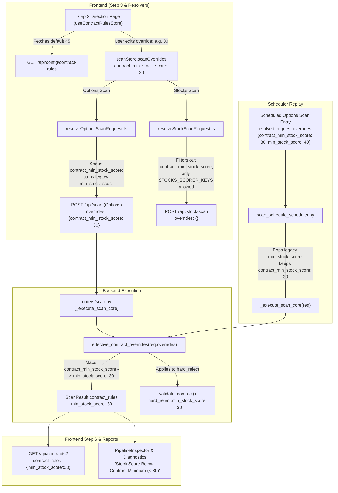

# OPTIONS-CONTRACT-FLOOR-OVERRIDE Implementation Plan

**Phase:** `OPTIONS-CONTRACT-FLOOR-OVERRIDE`  
**Tracking issue:** [#389](https://github.com/Netke237/trading-assistant/issues/389)  
**Branch:** `board/options-contract-floor-override-cc55c73a`  
**Base commit:** `dccf30583e572ff46120eab0d575453b69211297` (`origin/main`)  
**Design / decision:** Kenneth 2026-10-16 in chat (reopens deferred open question #8; stock CAUTION band 35 stays, no override).

---

## 1. Goal and Problem Statement

Currently, the options underlying-score hard-reject floor (`min_stock_score: 45`) lives exclusively in `backend/config/contract_rules.yaml`. When testing or inspecting candidate options on underlyings scoring between 30 and 44, all contracts are rejected with `stock_score_below_threshold`, producing an empty result set.

The existing Step 3 "Min stock score" control (`section: 'stocks'`, Score Gate) is strictly stocks-mode only (`min: 35`). To prevent it from inadvertently modifying the options contract floor, two guards exist:
1. `frontend/lib/resolveOptionsScanRequest.ts` explicitly strips `min_stock_score` from options scan requests.
2. `backend/app/services/scan_schedule_scheduler.py` explicitly executes `req.overrides.pop("min_stock_score", None)` to clean legacy schedules.

If an options floor override were sent as `min_stock_score`, guard 1 would strip it from manual scans and guard 2 would strip it from scheduled options scans, silently executing on the 45 default without error.

**Solution:**
1. Introduce a distinct, dedicated key end-to-end: `contract_min_stock_score`.
2. A single translation point on the backend (`contract_validator.effective_contract_overrides()`) translates `contract_min_stock_score` into `min_stock_score`. Both `validate_contract()` and `ScanResult.contract_rules` read through this single function, guaranteeing zero drift between applied rules and recorded rules. If both keys arrive, `contract_min_stock_score` wins.
3. The recorded `contract_rules` continues to carry the translated key `min_stock_score`, ensuring Step 6 `/api/contracts` queries and `PipelineInspector` diagnostic labels continue working with zero breaking changes.
4. Existing guards (1 and 2) remain untouched to continue stripping legacy/stocks `min_stock_score`.
5. The Stocks resolver (`resolveStockScanRequest.ts`) filters out `contract_min_stock_score`, preventing it from ever being sent in a stocks scan request.
6. The frontend Step 3 "Execution Parameters" panel surfaces the new parameter under `section: 'options', subGroup: 'Contract'` with label `"Min underlying score (contract floor)"` and bounds `0..100, step 1`.
7. The default shown in the UI is read dynamically from the backend (`GET /api/config/contract-rules`) to avoid hardcoding a duplicate 45 in the frontend. Resetting the field restores the YAML default.

---

## 2. Architecture and Data Flow



---

## 3. Detailed Specifications

### 3.1 Backend Contract Validator & Translation

**File:** `backend/app/scoring/contract_validator.py`

1. **Numeric validator and boundary check:**
   Define `_int_score_floor(val: Any) -> int`:
   - Checks that `val` is not a boolean and is a real `int` or `float`.
   - Checks `math.isfinite(val)`. Non-finite (NaN, Inf) raises `ValueError("contract_min_stock_score must be finite")`.
   - Converts to integer `i = int(val)`.
   - Checks `0 <= i <= 100`. Out-of-bounds raises `ValueError(f"contract_min_stock_score must be in 0..100: {i}")`.
   - Returns `i`.

2. **Table definition:**
   Update `_CONTRACT_OVERRIDES["min_stock_score"] = ("hard_reject", _int_score_floor)`.

3. **Translation in `effective_contract_overrides(overrides: dict | None) -> dict[str, float | int]`:**
   ```python
   def effective_contract_overrides(overrides: dict | None) -> dict[str, float | int]:
       """The contract-rule overrides validate_contract() applies for `overrides`:
       only the keys it reads, each cast exactly as it casts them. Raises
       ValueError/TypeError on a value the cast refuses, as validate_contract would.

       A scan records this on its result (ScanResult.contract_rules) and Step 6
       sends it back to /api/contracts, so the contracts table grades every
       contract with the rules the trade cards were graded with.

       OPTIONS-CONTRACT-FLOOR-OVERRIDE (#389): maps `contract_min_stock_score` to
       the `hard_reject.min_stock_score` override. If both `min_stock_score` and
       `contract_min_stock_score` arrive, `contract_min_stock_score` wins.
       """
       res: dict[str, float | int] = {
           key: _CONTRACT_OVERRIDES[key][1](val)
           for key, val in (overrides or {}).items()
           if key in _CONTRACT_OVERRIDES
       }
       if overrides and "contract_min_stock_score" in overrides:
           val = overrides["contract_min_stock_score"]
           if val is not None:
               res["min_stock_score"] = _int_score_floor(val)
       return res
   ```

### 3.2 Backend Config Endpoint

**File:** `backend/app/routers/config.py`

Add endpoint:
```python
@router.get("/contract-rules")
def get_contract_rules() -> dict:
    """Return default contract thresholds from contract_rules.yaml.
    Used by frontend Step 3 to display the default contract floor without hardcoding.
    """
    from app.scoring.contract_validator import _load_config
    cfg = _load_config()
    hard_reject = cfg.get("hard_reject", {})
    return {
        "min_stock_score": int(hard_reject.get("min_stock_score", 45)),
    }
```

### 3.3 Frontend API & Store

1. **File:** `frontend/lib/api.ts`
   Add method:
   ```ts
   getContractRules: () => get<{ min_stock_score: number }>('/api/config/contract-rules'),
   ```

2. **File:** `frontend/lib/contractRulesStore.ts` (new file)
   Zustand store following the `eventThresholdsStore` / `ivThresholdsStore` pattern:
   ```ts
   import { create } from 'zustand';
   import { api } from '@/lib/api';

   interface ContractRulesState {
     minStockScore: number | null;
     status: 'idle' | 'loading' | 'ready' | 'failed';
     fetch: () => Promise<void>;
   }

   export const useContractRulesStore = create<ContractRulesState>((set, get) => ({
     minStockScore: null,
     status: 'idle',
     fetch: async () => {
       if (get().status === 'loading') return;
       set({ status: 'loading' });
       try {
         const res = await api.getContractRules();
         if (res && typeof res.min_stock_score === 'number' && Number.isFinite(res.min_stock_score)) {
           set({ minStockScore: res.min_stock_score, status: 'ready' });
         } else {
           set({ status: 'failed' });
         }
       } catch {
         set({ status: 'failed' });
       }
     },
   }));
   ```

### 3.4 Step 3 Direction UI Integration

**File:** `frontend/app/(frame)/screener/step-3-direction/page.tsx`

1. Add parameter definition to `PARAM_DEFS`:
   ```tsx
   {
     key: 'contract_min_stock_score',
     label: 'Min underlying score (contract floor)',
     type: 'number',
     section: 'options',
     subGroup: 'Contract',
     min: 0,
     max: 100,
     step: 1,
     hint: 'Judges the underlying stock score before contracts are graded. Separate from the Stocks min score; default comes from contract_rules.yaml.',
   },
   ```

2. On mount, trigger `useContractRulesStore.getState().fetch()`.
3. In `displayDefaults`:
   ```tsx
   const contractMinStockScoreDefault = useContractRulesStore((s) => s.minStockScore);
   const displayDefaults: ParamDefaults = {
     ...defaults,
     min_dte: previewMinDte,
     max_dte: previewMaxDte,
     contract_min_stock_score: contractMinStockScoreDefault,
   };
   ```
4. Resetting the field via backspace or clearing the input deletes `contract_min_stock_score` from `scanOverrides`, reverting the scan request to default.

### 3.5 Resolvers and Guards Verification

1. **`frontend/lib/resolveOptionsScanRequest.ts`:**
   - Strips `min_stock_score` from `scanOverrides` (existing guard preserved).
   - Keeps `contract_min_stock_score` in `scoreOnlyOverrides`, forwarded to `effectiveOverrides`.
2. **`frontend/lib/resolveStockScanRequest.ts`:**
   - Excludes `contract_min_stock_score` because it is not in `STOCKS_SCORER_KEYS`.
   - `StockScanRequestBody` does not include `contract_min_stock_score`.
3. **`backend/app/services/scan_schedule_scheduler.py`:**
   - Preserves `contract_min_stock_score` in `req.overrides` while continuing to pop `min_stock_score` (lines 184).

---

## 4. Tickets and Task Breakdown

### Ticket 1: Backend Contract Validator Translation and Config Endpoint
- Implement `_int_score_floor` in `backend/app/scoring/contract_validator.py`.
- Implement `contract_min_stock_score` translation in `effective_contract_overrides`.
- Implement `GET /api/config/contract-rules` in `backend/app/routers/config.py`.
- Add test suite `backend/tests/test_contract_rules_config_endpoint.py`.
- Extend `backend/tests/test_contract_validator.py` with translation precedence and boundary assertions.
- Extend `backend/tests/test_scan_schedule.py` with scheduler preservation test.
- Commit: `feat(scoring): translate contract_min_stock_score override and expose contract rules endpoint`

### Ticket 2: Frontend Store, Resolver Wiring and Step 3 UI
- Add `getContractRules` to `frontend/lib/api.ts`.
- Create `frontend/lib/contractRulesStore.ts` and test suite `frontend/lib/__tests__/contractRulesStore.test.ts`.
- Update `PARAM_DEFS` and `displayDefaults` in `frontend/app/(frame)/screener/step-3-direction/page.tsx`.
- Add unit tests verifying `resolveOptionsScanRequest` forwards `contract_min_stock_score` and `resolveStockScanRequest` drops it.
- Add component test in `frontend/app/(frame)/screener/step-3-direction/__tests__/contractMinStockScore.test.tsx`.
- Commit: `feat(screener): add options contract floor override control in Step 3`

### Ticket 3: End-to-End Integration Tests & Verification
- Verify acceptance criteria 1 through 7 across manual options scan, scheduled options scan, legacy schedule replay, report label display, and stock scan isolation.
- Run typecheck, Jest suites, and pytest.
- Commit: `test(e2e): verify contract floor override lifecycle and report labels`

---

## 5. Acceptance Criteria Checklist

- [ ] 1. Manual options scan with `contract_min_stock_score` set to 30: contracts of an underlying with stock score between 30 and 44 are not rejected with `stock_score_below_threshold`. Scan report label reads `Stock Score Below Contract Minimum (< 30)`.
- [ ] 2. Field reset (cleared/empty): the next options scan applies 45 from `contract_rules.yaml`, and the report shows `< 45`.
- [ ] 3. Scheduled options scan saved with `contract_min_stock_score` at 30: runs with 30 (proven by test in `test_scan_schedule.py`).
- [ ] 4. Legacy schedule whose `resolved_request.overrides` carries `min_stock_score`: still stripped by the scheduler, and runs on YAML 45.
- [ ] 5. A Stocks-field `min_stock_score` value never affects the contract floor on manual or scheduled options paths.
- [ ] 6. Stocks scans, the 35 band, PASS 55 threshold, and auto-trader behavior are completely unchanged.
- [ ] 7. Backend tests on Python 3.11 pass, `npm run typecheck` clean, Jest suites all pass. Independent adversarial audit clean before merge.
